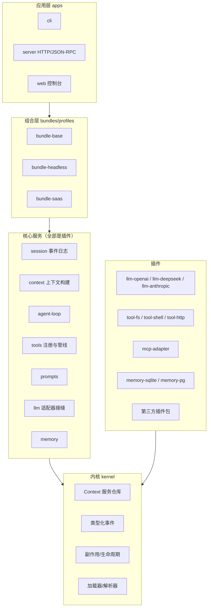
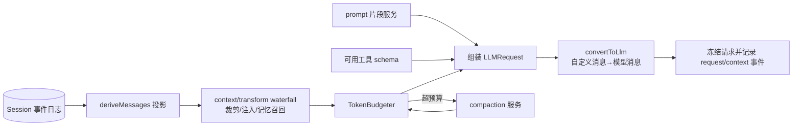
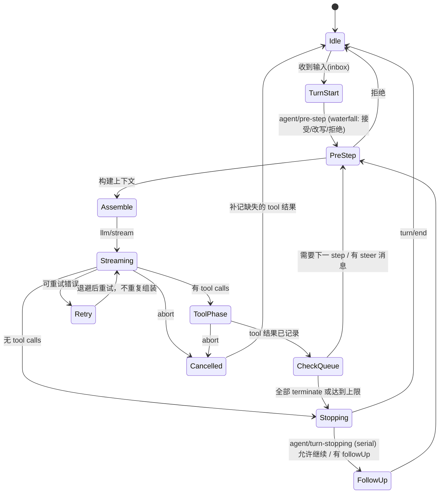
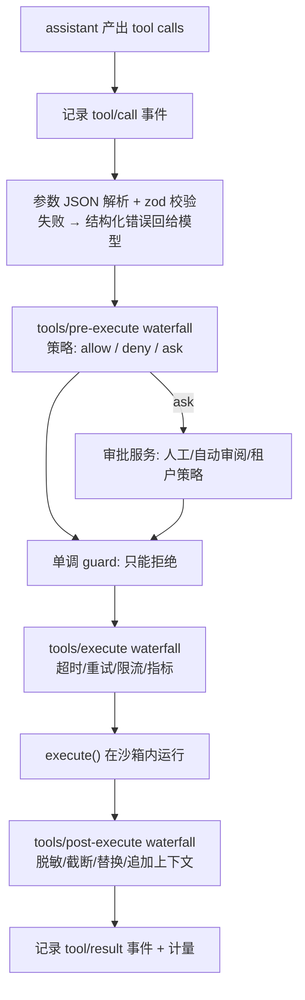
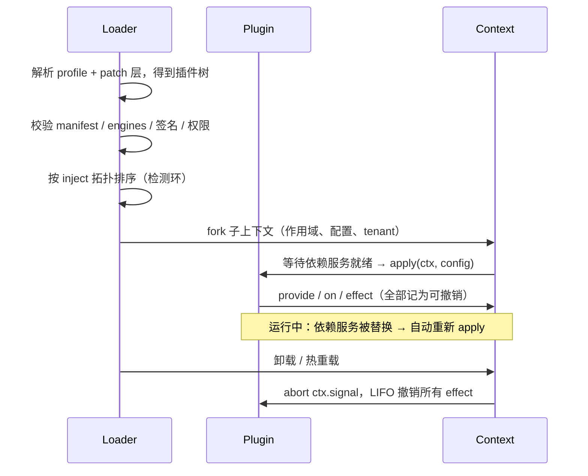
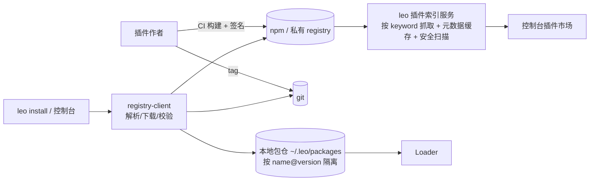

# leo-agents 架构规划：可插件化、可商用的 TypeScript Agent

> 版本：v0.1（规划稿） · 日期：2026-10-30 · 语言：TypeScript（Node.js ≥ 22）
>
> 本文是 leo-agents 从零手写（不依赖现成 agent 框架）的总体设计。主要参考两个开源项目：
> **DeepSeek Harness**（“一切皆插件”）和 **pi**（Mario Zechner 的极简 agent harness，原 `badlogic/pi-mono`）。
> 文中凡标注“已核实”的内容都来自下方“参考资料”中的一手文档；凡标注“leo 设计”的内容是本项目自己的方案，不代表上游实现。

---

## 目录

1. [调研结论速览](#1-调研结论速览)
2. [DeepSeek Harness 调研](#2-deepseek-harness-调研)
3. [pi（pi-mono）调研](#3-pipi-mono调研)
4. [其他生态简记与对比表](#4-其他生态简记与对比表)
5. [leo-agents 设计原则](#5-leo-agents-设计原则)
6. [整体架构与目录结构](#6-整体架构与目录结构)
7. [内核：插件运行时（Context / Service / Event / Effect）](#7-内核插件运行时)
8. [核心模块一：上下文构建](#8-核心模块一上下文构建)
9. [核心模块二：Agent 循环](#9-核心模块二agent-循环)
10. [核心模块三：工具调用](#10-核心模块三工具调用)
11. [插件协议](#11-插件协议)
12. [插件包的分发、发现与安装](#12-插件包的分发发现与安装)
13. [提示词组织](#13-提示词组织)
14. [对照表：DeepSeek Harness / pi → leo-agents](#14-对照表)
15. [商用就绪](#15-商用就绪)
16. [路线图与里程碑](#16-路线图与里程碑)
17. [风险与待定事项](#17-风险与待定事项)
18. [参考资料](#18-参考资料)

---

## 1. 调研结论速览

| 结论 | 说明 |
|---|---|
| DeepSeek Harness 真实存在 | `deepseek-ai/deepseek-harness`，MIT 许可，TypeScript/Node 实现，口号 “Everything is a Plugin”，目前是 **developer preview**，官方明确会有破坏性变更。 |
| DSH 的插件化来自 Cordis | 底层是 vendored 的 Cordis 框架：插件向共享 `ctx` 贡献 **服务（service）**、**类型化事件（typed events）** 和 **可撤销副作用（effects）**；连模型适配器、工具注册表、会话日志、agent loop 本身都是插件。 |
| pi 真实存在 | `badlogic/pi-mono` 现已重定向到 `earendil-works/pi`，npm 包名从 `@mariozechner/*` 迁到 `@earendil-works/*`，MIT 许可。 |
| pi 的思路是“极简内核 + 外挂扩展” | 分层清晰：`pi-ai`（统一 LLM API）→ `pi-agent-core`（agent 循环 + 工具调用 + 状态）→ `pi-coding-agent`（CLI，提供 extensions / skills / prompt templates / themes，并打包成 **Pi packages** 通过 npm/git 分发）。 |
| leo-agents 的取舍 | **内核用 DSH 的“服务 + 事件 + effect”运行时**（可替换一切、可热卸载）；**开发者体验和分发用 pi 的方式**（一个函数就是一个扩展；`package.json` 里加一个字段就是插件包；skills 和 prompt 模板用 Markdown）；**再补上两者都没做的商用能力**：多租户、权限沙箱、计量计费、签名校验、私有插件仓库。 |

---

## 2. DeepSeek Harness 调研

> 来源：仓库 README、`docs/architecture.md`、`docs/cordis-primer.md`、`docs/cordis-tutorial/*`、`docs/cookbook/adding-a-tool.md`、`docs/tool-execution-pipeline.md`（见第 18 节）。以下全部为**已核实**内容。

### 2.1 定位

- `dsh` 是 DeepSeek 开源的 agent harness，可以作为 Web UI（`npx @deepseek-ai/dsh web`）、桌面端（Electron）、headless、SDK（JSON-RPC）、ACP 服务器等形态运行，也有 Python SDK。
- 官网称其支持 “Creator mode”：在对话里让 agent 自己写插件并安装（官网演示：写一个番茄钟悬浮窗插件，调用 `plugin_manager · install_bundle`）。

### 2.2 Cordis 五个核心概念（已核实）

1. **插件就是一个实现了 Service 的对象**：可以是带 `name`、`inject`、`apply(ctx)` 的模块，也可以是 `Service` 子类。
2. **Context 是服务仓库**：服务占用一个稳定的键，如 `ctx.tools`、`ctx.llm`、`ctx.sessions`；其他插件按键查找，而不是 import 具体实现。
3. **用 `inject` 声明依赖**：依赖的服务就绪前插件不会启动，加载顺序由依赖关系推导，不需要手动排启动顺序。
4. **类型化事件**：通过 TypeScript declaration merging 声明事件；分发模式有 `emit`（观察）、`waterfall`（洋葱式中间件，需调用 `next()`）、`parallel`（并发）、`serial`（串行可返回值）、`bail`（第一个返回值即终止）。分发模式是事件公共契约的一部分。
5. **注册即可撤销的副作用**：prompt 片段、工具 schema、适配器、监听器都通过 `ctx.effect()` / `ctx.on()` 注册，插件卸载或热重载时自动按序撤销。

最小插件（来自官方示例）：

```ts
export const name = 'my-tool-plugin'
export const inject = ['tools']
export function apply(ctx) {
  ctx.tools.register({ name: 'example', description: 'Example', parameters: {} })
}
```

### 2.3 核心包与 `ctx` 键（已核实）

| 包 | 负责 | `ctx` 键 |
|---|---|---|
| `core/session` | 只追加的 `SessionEvent` 日志与内存存储 | `ctx.sessions` |
| `core/system-prompt` | prompt 片段与工具 schema 组装 | `ctx.systemPrompt` |
| `core/tools` | 作用域化的工具注册表与受控执行管线 | `ctx.tools` |
| `core/agent` | `Agent` 接口、活跃注册表、`agent/*` 事件 | `ctx.agents` |
| `core/agent-loop` | 默认的 loop 驱动 | `ctx.agentLoop` |
| `core/scope` | 按 agent 作用域注册的原语 | （库） |
| `llm/llm` | 消息与流的词汇表 + 适配器接缝 | `ctx.llm` |

`packages/` 下按领域分目录（通过 GitHub API 列出的部分）：`acp`、`api`、`attachment`、`boot`、`browser-use`、`bundle`、`client`、`compaction`、`computer-use`、`context`、`core`、`credentials`、`fs`、`goal`、`guard`、`jobs`、`llm`、`lsp`、`mcp`、`plan`、`preset`、`sandbox`、`schedule`、`sdk` 等，说明**每个能力都是独立包**。

### 2.4 Profile / Bundle 组合（已核实）

- 运行中的 `dsh` 是启动时由**有序层**组合出的插件树。
- **Bundle**：Cordis 配置行 + 其挂载代码的分发格式；**Profile**：一组有序 bundle + 用户的 `cordis.patch.yml`。内置 profile：`web`、`headless`、`sdk`、`sdk-minimal`、`acp`。
- 层的叠加顺序：profile 的 bundle → profile patch → home patch → `--patch` 覆盖。patch 可以按 id 替换某一行配置，或插入新行。`dsh --profile web --dump-config` 可以打印最终插件树。
- 在 `package.json` 中用 `dsh` 字段自描述：`dsh.profile` 列出 bundle，`dsh.bundle` 指向 patch 文件。

### 2.5 Turn / Step 与事件（已核实）

- **step** = 一次模型请求 + 它调用的工具；**turn** = 0 个或多个 step。
- 三类事件：**Session 事件**（持久化事实，可回放）、**Agent 事件** `agent/*`（拦截进行中的工作）、**能力事件**（`fs/*`、`tools/*`、`telemetry/*`，给某个接缝挂策略）。
- `agent/pre-step`、`llm/stream`、`tools/pre-execute`、`tools/execute`、`tools/post-execute` 都是 waterfall；`agent/turn-stopping` 是 serial。
- 原则：**“模型可见即已记录”（Model-visible means logged）**——每一次模型请求都必须能从会话日志重建。

### 2.6 工具管线（已核实）

`tool/call 记录` → `tools/pre-execute`（hook、权限、沙箱；可 allow / deny / ask）→ 单调 guard（只能拒绝，后续监听器无法撤销）→ `tools/execute`（超时、重试、指标，包裹实际执行）→ 工具 `execute()` → `tools/post-execute`（接受、拦截、替换、补充上下文）→ `tool/result 记录`。工具通过 `defineTool` 定义，参数有 schema 并在执行前校验，`execute` 必须遵守 `exec.signal` 取消信号，返回规范化 JSON 值，再由 `output.render` 渲染给模型。

### 2.7 “接缝（seam）”

一个可替换能力 = **Service Definition（接口）+ Service Provider（实现）+ Consumer（使用方，常是工具）**。例如文件系统与子进程 provider 共享一个执行环境，换成远程沙箱时 Bash、PTY、LSP 一起迁移。

### 2.8 未能核实 / 需注意

- DSH 处于 developer preview，API 变化快，本文引用的是 2026-10 时的 `master` 文档。
- 插件市场/官方插件目录的服务端协议（如签名、审核流程）在公开文档中**没有找到**，因此本文不对其做假设。
- Cordis 的论文《A Programming Paradigm for Spatiotemporal Composability》只看到 README 引用，未阅读原文。

---

## 3. pi（pi-mono）调研

> 来源：仓库 README、`packages/agent/README.md`、`packages/ai/README.md`、`packages/coding-agent/docs/{extensions,packages,skills,prompt-templates}.md`。以下为**已核实**内容。

### 3.1 定位与分层

“Pi is a minimal, extensible agent harness that you can make your own.” —— 内置默认功能刻意很少（比如不内置 sub-agent、plan mode），需要的话装包或者让 pi 自己写。

| 包 | 作用 |
|---|---|
| `@earendil-works/pi-ai` | 统一多厂商 LLM API（OpenAI、Anthropic、Google 等），含 token/成本追踪、流式 tool call（partial JSON）、参数校验、思考/推理统一接口、中途换模型 |
| `@earendil-works/pi-agent-core` | agent 运行时：工具调用 + 状态管理 + 事件流 |
| `@earendil-works/pi-coding-agent` | 交互式编码 CLI，承载 extensions / skills / prompts / themes / packages |
| `@earendil-works/pi-tui` | 终端 UI（差分渲染） |
| `@earendil-works/chord` | 可热重载插件、契约、复制状态、JSON 链路 RPC 的类型化宿主运行时 |
| `pi-telemetry` / `pi-durable` | 遥测契约；持久化对话/任务/文档运行时 |

### 3.2 极简 Agent 循环（已核实）

```text
AgentMessage[] → transformContext() → AgentMessage[] → convertToLlm() → Message[] → LLM
                   （可选：裁剪、注入）               （必需：过滤 UI 消息、转换自定义类型）
```

事件序列：`agent_start → turn_start → message_start/update/end → tool_execution_start/update/end → turn_end → … → agent_end`。

关键设计点：
- `AgentMessage` 可通过 declaration merging 扩展自定义消息类型，送给模型前由 `convertToLlm` 转换。
- 工具执行默认 `parallel`：先**串行预检**，再**并发执行**；结果消息仍按 assistant 原始顺序落盘。单个工具可声明 `executionMode: "sequential"`，会使整批串行。
- `beforeToolCall`（可阻止执行）/ `afterToolCall`（可改写结果）钩子；工具结果可带 `terminate: true`，整批都 terminate 时跳过下一次 LLM 调用。
- **steer / followUp 队列**：运行中插话（steering）和结束后追加（follow-up）是一等公民。
- 工具失败时**抛异常**，不要把错误当正常内容返回。

### 3.3 扩展（Extension）系统（已核实）

- 扩展就是一个 TS 模块：`export default function (pi: ExtensionAPI) { ... }`。
- 能力：`pi.on(event)` 订阅/拦截事件，`pi.registerTool`、`registerCommand`、`registerProvider`、`registerMcpServer`、`registerShortcut`、`registerFlag`、`registerMessageRenderer`，`pi.appendEntry` 持久化状态，`ctx.ui` 交互，`ctx.compact()` 自定义压缩等。
- 事件处理器组合语义：**通知**（忽略返回值）、**原地修改**、**链式变换**（后一个拿到前一个的返回值）、**闸门**（拦截后不走默认路径）、**最后覆盖**。并建议安全闸门在无法判断时“失败即关闭（fail closed）”。
- 自动发现位置：`~/.pi/agent/extensions/`（全局）与 `.pi/extensions/`（项目级，**需先信任项目**）；支持单文件、`*/index.ts`、带 `pi.extensions` 字段的 `package.json`；`/reload` 热重载。
- 宿主提供的包（`pi-ai`、`pi-agent-core`、`pi-coding-agent`、`pi-tui`、`typebox`）会被映射到宿主自身副本，扩展应把它们写在 `peerDependencies: "*"`，不能打包进去，避免重复的类/注册表。

### 3.4 Pi Packages：分发（已核实）

```bash
pi install npm:@example/pi-tools@1.0.0
pi install git:github.com/example/pi-tools@v1
pi install ./local-package
```

```json
{
  "name": "my-pi-package",
  "keywords": ["pi-package"],
  "pi": {
    "extensions": ["./src/extension.ts"],
    "skills": ["./resources/skills"],
    "prompts": ["./resources/prompts/*.md"],
    "themes": ["./resources/themes/*.json"]
  }
}
```

- 没有 `pi` 字段时按约定目录 `extensions/ skills/ prompts/ themes/` 发现。
- `pi-package` 关键字让包出现在 pi.dev 的包画廊。
- npm 版本号、git tag/commit 被固定（pin）；安装失败时警告并跳过，不阻塞启动。
- 每个包独立 module root，不能依赖别的包未声明的依赖。
- 供应链加固：直接依赖精确版本、`min-release-age=2`、`--ignore-scripts`、`npm audit signatures`。

### 3.5 Skills 与 Prompt 模板（已核实）

- **Skill** = 一个含 `SKILL.md`（frontmatter：`name`、`description`）的目录，可附脚本、参考文档、资源；遵循 Agent Skills 规范。启动时只把名称、描述、路径放进 system prompt，任务匹配时模型再读全文（**渐进式披露**，节省上下文）。
- **Prompt 模板** = Markdown 文件，文件名即 `/命令`，支持 `$1`、`$@`、`${1:-default}` 等参数替换。

### 3.6 安全立场（已核实）

pi **没有内置权限系统**，扩展拥有进程的全部权限；官方建议用容器/微 VM 做隔离。这对商用来说是需要补上的部分。

---

## 4. 其他生态简记与对比表

> 用户已明确：主要参考对象是 DeepSeek Harness 与 pi。以下其他框架只作简单对照（基于公开文档的一般认知，未逐条复核细节）。

- **MCP（Model Context Protocol）**：跨进程/跨语言的工具、资源、prompt 协议（stdio / Streamable HTTP）。DSH（有 `packages/mcp`）和 pi（`pi.registerMcpServer`）都支持，leo 也应把 MCP 作为“外部工具插件”的标准适配。
- **Vercel AI SDK / OpenAI Agents SDK / Mastra**：工具 = schema（zod）+ execute；适合作为 provider 层参考。
- **LangChain / LangGraph**：Runnable 组合 + callbacks；抽象层级多，leo 不照搬。

| 维度 | DeepSeek Harness | pi | MCP | leo-agents（设计） |
|---|---|---|---|---|
| 插件单位 | Cordis 插件（`name/inject/apply`） | 扩展函数 `(pi) => void` | 独立 server 进程 | `definePlugin({ name, inject, apply })`，兼容函数式简写 |
| 内核可替换性 | 极高（loop 本身也是插件） | 中（内核固定，靠事件钩子） | 不涉及 | 高（loop、llm、memory 都是服务） |
| 依赖/顺序 | `inject` 按服务就绪 | 加载顺序 | 不涉及 | `inject` + 拓扑排序 + semver 校验 |
| 拦截机制 | waterfall/serial/bail 等事件模式 | 通知/变换/闸门/覆盖 | 不涉及 | 采用 DSH 的分发模式，命名采用 pi 的直观事件名 |
| 卸载/热重载 | effect 自动撤销 | `/reload` | 重启进程 | effect 自动撤销 + 热重载 |
| 组合配置 | profile + bundle + patch 层 | settings.json + packages | 客户端配置 | profile + 多层 patch（YAML） |
| 分发 | bundle（`package.json` 的 `dsh` 字段） | Pi packages（npm/git，`pi` 字段） | 各自分发 | `leo` 字段 + npm/git/私有 registry + 签名 |
| Skills / Prompt | prompt 片段服务 | SKILL.md + Markdown 模板 | prompts 原语 | 两者结合：片段服务 + Markdown 资源 |
| 权限/沙箱 | 有（approval、guard、sandbox 后端） | 无（建议容器） | 依赖宿主 | 能力声明 + 审批 + 沙箱后端 + 租户策略 |
| 持久化原则 | 只追加事件日志，模型可见即已记录 | session 树、appendEntry | 不涉及 | 只追加事件日志（采用 DSH 原则） |

---

## 5. leo-agents 设计原则

1. **一切皆插件，内核只做三件事**：服务注册、事件分发、副作用生命周期。（DSH）
2. **最小可用路径极短**：一个函数就能写插件，一个 `package.json` 字段就能发布。（pi）
3. **模型可见即已记录**：每次 LLM 请求都能从事件日志完全重建，便于审计、回放、计费、评测。（DSH）
4. **默认安全**：插件声明所需权限；项目级/第三方插件需信任；危险工具需审批；失败即关闭。（补 pi 的短板）
5. **多租户从第一天开始**：所有服务调用都带 `TenantContext`，配置、凭据、配额、计量按租户隔离。
6. **协议优先**：对外暴露稳定的 SDK 与 JSON-RPC/HTTP 协议；MCP 作为外部工具标准。
7. **可测试**：每个插件可以脱离 LLM 用 mock provider 单测；有 eval 套件回归。

---

## 6. 整体架构与目录结构

### 6.1 分层图



### 6.2 目录结构（pnpm workspaces monorepo，按功能组织）

```text
leo-agents/
├── package.json                    # 根：workspace 脚本、engines
├── pnpm-workspace.yaml
├── turbo.json                      # 构建/测试编排（可选 nx）
├── tsconfig.base.json
├── biome.json                      # lint + format
├── .changeset/                     # 版本与 changelog 管理
├── .github/workflows/              # CI：lint、type-check、test、eval、release、签名
├── docs/
│   ├── architecture-plan.md        # 本文
│   ├── plugin-authoring.md         # 插件开发指南
│   ├── events-catalog.md           # 事件目录（脚本生成）
│   └── adr/                        # 架构决策记录
├── packages/
│   ├── kernel/                     # @leo/kernel —— 只有插件运行时
│   │   └── src/
│   │       ├── context.ts          # Context：服务仓库、子上下文、作用域
│   │       ├── service.ts          # Service 基类、inject 解析
│   │       ├── events/             # emit / waterfall / serial / parallel / bail
│   │       ├── effect.ts           # 可撤销副作用、Disposable 栈
│   │       ├── loader/             # 配置解析、拓扑排序、热重载
│   │       ├── manifest.ts         # 插件 manifest 的 zod schema
│   │       └── index.ts
│   ├── protocol/                   # @leo/protocol —— 共享类型：消息、事件、工具、错误码
│   ├── core/
│   │   ├── session/                # 只追加事件日志 + 投影（deriveMessages）
│   │   ├── context/                # 上下文构建器、token 预算、压缩接缝
│   │   ├── agent-loop/             # 默认 loop 驱动（状态机）
│   │   ├── tools/                  # 工具注册表、校验、执行管线、并发调度
│   │   ├── prompts/                # prompt 片段注册、模板渲染、版本
│   │   ├── llm/                    # 统一 LLM 接口与流事件词汇（接缝）
│   │   ├── memory/                 # 记忆接口（短期/长期/向量）
│   │   ├── permissions/            # 权限声明、审批、guard
│   │   └── config/                 # 分层配置 + 密钥引用
│   ├── llm/
│   │   ├── openai/                 # OpenAI 兼容（含 DeepSeek、通义、Kimi 等兼容端点）
│   │   ├── anthropic/
│   │   ├── google/
│   │   └── mock/                   # 测试用确定性模型
│   ├── tools/
│   │   ├── fs/                     # read / write / edit / glob / grep
│   │   ├── shell/                  # bash（经 sandbox 后端）
│   │   ├── http/                   # fetch，带域名白名单
│   │   └── todo/
│   ├── memory/
│   │   ├── in-memory/
│   │   ├── sqlite/
│   │   └── postgres-pgvector/
│   ├── sandbox/
│   │   ├── local/                  # 仅开发用
│   │   ├── docker/
│   │   └── remote/                 # 远端执行环境（e2b/firecracker 等）
│   ├── mcp/                        # MCP 客户端适配：把 MCP server 映射为工具服务
│   ├── skills/                     # SKILL.md 发现与渐进加载
│   ├── compaction/                 # 摘要式压缩、裁剪策略
│   ├── observability/              # OpenTelemetry tracing、metrics、日志
│   ├── billing/                    # 用量计量 hooks、配额
│   ├── tenancy/                    # 租户上下文、隔离、限流
│   ├── registry-client/            # 插件包解析、下载、签名校验、锁文件
│   ├── sdk/                        # @leo/sdk：对外嵌入式 API
│   └── create-leo-plugin/          # 脚手架：npm create leo-plugin
├── bundles/
│   ├── base/                       # 默认插件集合 + patch.yml
│   ├── headless/
│   └── saas/                       # 多租户服务端组合
├── apps/
│   ├── cli/                        # leo 命令：run / install / list / dump-config
│   ├── server/                     # HTTP + SSE + JSON-RPC
│   └── console/                    # Web 管理控制台（后期）
├── examples/
│   ├── plugins/hello-tool/
│   ├── plugins/permission-gate/
│   └── plugins/custom-compaction/
├── evals/                          # 评测集与评分器
└── prompts/                        # 内置提示词资源（Markdown + frontmatter）
    ├── system/
    ├── roles/
    └── tasks/
```

包命名：`@leo/kernel`、`@leo/core-*`、`@leo/llm-*`、`@leo/tool-*`；第三方插件约定 `leo-plugin-*` 或 `@scope/leo-plugin-*`。

---

## 7. 内核：插件运行时

内核借鉴 Cordis 的概念自己实现（体量控制在 ~1–2k 行），不直接依赖 Cordis，以便自主控制 API 稳定性与许可。

```ts
// packages/kernel/src/types.ts
export type Disposer = () => void | Promise<void>

export interface Services {}          // 通过 declaration merging 扩展：ctx.tools、ctx.llm ...
export interface Events {}            // 通过 declaration merging 扩展事件签名

export type DispatchMode = 'emit' | 'waterfall' | 'serial' | 'parallel' | 'bail'

export interface Context<C = unknown> {
  readonly plugin: PluginRuntime
  readonly config: C
  readonly tenant?: TenantContext
  readonly logger: Logger
  readonly signal: AbortSignal                       // 插件卸载即 abort

  /** 注册服务：同一个键同时只有一个提供者（可被更高层 patch 替换） */
  provide<K extends keyof Services>(key: K, impl: Services[K]): Disposer
  get<K extends keyof Services>(key: K): Services[K]

  on<E extends keyof Events>(event: E, handler: Events[E], opts?: { prepend?: boolean }): Disposer
  emit<E extends keyof Events>(event: E, ...args: Parameters<Events[E]>): void
  waterfall<E extends keyof Events>(event: E, ...args: any[]): Promise<any>
  serial<E extends keyof Events>(event: E, ...args: any[]): Promise<any>
  parallel<E extends keyof Events>(event: E, ...args: any[]): Promise<void>
  bail<E extends keyof Events>(event: E, ...args: any[]): Promise<any>

  /** 任意可撤销副作用；插件卸载时按 LIFO 顺序撤销 */
  effect(setup: () => Disposer | Promise<Disposer>): Promise<void>

  /** 加载子插件（形成插件树） */
  plugin<T>(p: PluginLike<T>, config?: T): Promise<PluginRuntime>
  /** 派生作用域（如按 agent / 按租户） */
  fork(scope: { agentId?: string; tenantId?: string }): Context<C>
}

declare module '@leo/kernel' {
  // ctx.tools 等通过此方式获得类型（示例）
}
```

**waterfall 语义（与 DSH 相同）**：监听器签名 `(payload, next) => result`，调用 `next()` 交给下一个，不调用则短路。
**事件分发模式写进事件声明**，`docs/events-catalog.md` 由脚本从源码中的 `@mode` 注释生成，CI 检查声明与分发点一致。

---

## 8. 核心模块一：上下文构建

### 8.1 数据流



（`transformContext → convertToLlm` 两段式来自 pi；“冻结并记录”来自 DSH 的“模型可见即已记录”。）

### 8.2 接口草图

```ts
// packages/core/context/src/types.ts
export interface AgentMessage {            // 可通过 declaration merging 扩展 role
  id: string
  role: 'system' | 'user' | 'assistant' | 'tool' | (string & {})
  content: ContentBlock[]
  meta?: Record<string, unknown>
  createdAt: number
}

export interface PromptSection {
  id: string                               // 例如 'core.identity'、'skill.index'
  layer: 'platform' | 'tenant' | 'agent' | 'task' | 'runtime'
  priority: number                         // 同层内排序
  cacheable?: boolean                      // 稳定前缀，利于 prompt cache
  render(input: AssembleInput): string | Promise<string>
}

export interface TokenBudget {
  modelWindow: number
  reserveForOutput: number
  reserveForTools: number
  softLimitRatio: number                   // 例如 0.8：超过即触发压缩
}

export interface ContextBuilder {
  registerSection(section: PromptSection): Disposer
  build(input: AssembleInput, signal: AbortSignal): Promise<BuiltContext>
}

export interface BuiltContext {
  system: string
  messages: LlmMessage[]
  tools: ToolSchema[]
  usage: { estimatedTokens: number; budget: TokenBudget }
  fingerprint: string                      // 用于缓存命中与回放校验
}

export interface CompactionStrategy {
  name: string
  shouldCompact(stats: ContextStats): boolean
  compact(messages: AgentMessage[], ctx: CompactionCtx): Promise<CompactionResult>
}
```

### 8.3 策略要点

- **Token 计数**：provider 插件提供 `countTokens`；没有时用 tokenizer 近似 + 安全系数；以真实返回的 `usage` 校准。
- **压缩**：默认策略 = 保留系统层 + 最近 N 轮 + 将更早内容摘要为一条 `compaction/summary` 事件（原日志不删，满足审计）；插件可替换策略（pi 的 `session_before_compact` 与 DSH 的 `compaction` 包都是这样做）。
- **大工具结果**：超过阈值的工具输出落到附件存储，只把截断版和引用放进上下文。
- **记忆**：`ctx.memory.recall(query)` 在 `context/transform` 中注入；长期记忆写入通过工具或 `turn/end` 钩子完成。
- **Prompt cache 友好**：稳定片段（platform/tenant 层）在前，易变片段（runtime 层）在后；`fingerprint` 用于检测前缀变化。

---

## 9. 核心模块二：Agent 循环

### 9.1 状态机



### 9.2 接口

```ts
// packages/core/agent-loop/src/types.ts
export interface Agent {
  readonly id: string
  readonly sessionId: string
  readonly ctx: Context                      // agent 作用域上下文（DSH core/scope 思路）
  readonly status: 'idle' | 'running' | 'stopping' | 'error'
  prompt(input: UserInput, opts?: RunOptions): AsyncIterable<AgentEvent>
  steer(msg: UserInput): void                // 运行中插话（pi）
  followUp(msg: UserInput): void             // 结束后追加（pi）
  inject(ctx: InjectedContext): void         // 下一请求可见的上下文（DSH agent.inject）
  abort(reason?: string): void
}

export interface RunOptions {
  maxSteps?: number                          // 默认 50
  maxTokens?: number                         // 整个 turn 的预算
  maxCostUsd?: number
  timeoutMs?: number
  toolExecution?: 'parallel' | 'sequential'
  signal?: AbortSignal
}

export type AgentEvent =
  | { type: 'turn_start'; turnId: string }
  | { type: 'step_start'; stepId: string }
  | { type: 'text_delta'; delta: string }
  | { type: 'reasoning_delta'; delta: string }
  | { type: 'tool_call'; call: ToolCall }
  | { type: 'tool_update'; callId: string; partial: unknown }
  | { type: 'tool_result'; callId: string; result: ToolResult }
  | { type: 'step_end'; usage: Usage }
  | { type: 'turn_end'; reason: StopReason; usage: Usage }
  | { type: 'error'; error: LeoError; retryable: boolean }

export type StopReason =
  | 'completed' | 'max_steps' | 'budget_exceeded' | 'terminated_by_tool'
  | 'rejected' | 'cancelled' | 'error'

export interface AgentLoopService {          // ctx.agentLoop —— 可整体替换
  create(opts: CreateAgentOptions): Promise<Agent>
}
```

### 9.3 关键行为

- **停止条件**：无 tool call；所有工具结果 `terminate: true`；`maxSteps`/预算/超时；`agent/turn-stopping` 监听器裁决；取消。
- **流式**：LLM 适配器输出统一事件（`text_delta`、`tool_call_delta`（partial JSON）、`reasoning_delta`、`usage`、`done`）；loop 转发为 `AgentEvent`；服务端以 SSE / JSON-RPC 通知推出。
- **错误与重试**：错误分类（`rate_limit`、`overloaded`、`timeout`、`context_overflow`、`auth`、`invalid_request`、`tool_error`）；前三类指数退避 + 抖动；`context_overflow` 触发强制压缩后重试一次；重试**不重复**上下文组装（DSH 做法），失败尝试作为 `assistant/attempt` 事件记录。
- **取消**：全链路 `AbortSignal`；取消后为未完成的 tool call 补记“cancelled”结果，保证日志可回放（DSH “failed steps record missing tool results”）。
- **并发**：同一 session 同时只能有一个活跃 turn（会话锁）；不同 session 并行。

---

## 10. 核心模块三：工具调用

### 10.1 定义

```ts
// packages/core/tools/src/define.ts
import { z } from 'zod'

export interface ToolDefinition<A extends z.ZodTypeAny = z.ZodTypeAny, R = unknown> {
  name: string                                // ^[a-z][a-z0-9_]{0,63}$，加命名空间前缀防冲突
  title?: string
  description: string                         // 给模型看
  parameters: A                               // zod -> JSON Schema（zod-to-json-schema / z.toJSONSchema）
  output?: z.ZodType<R>
  permissions?: Permission[]                  // 例：{ kind: 'fs.write', paths: ['${workspace}/**'] }
  executionMode?: 'parallel' | 'sequential'   // pi
  timeoutMs?: number
  idempotent?: boolean                        // 决定是否可自动重试
  costHint?: { unit: string; amount: number } // 计费钩子使用
  execute(args: z.infer<A>, exec: ToolExecContext): Promise<R>
  render?(args: z.infer<A>, value: R): ContentBlock[]   // 给模型的呈现（DSH output.render）
}

export interface ToolExecContext {
  callId: string
  agent: Agent
  tenant: TenantContext
  signal: AbortSignal                         // 必须遵守
  onUpdate(partial: unknown): void            // 流式进度（pi onUpdate）
  sandbox: SandboxHandle                      // 所有副作用必须经由沙箱后端
}

export const defineTool = <A extends z.ZodTypeAny, R>(d: ToolDefinition<A, R>) => d
```

### 10.2 执行管线（采用 DSH 的分层管线）



- **并行调用**：预检串行（保证审批顺序与可预测性），执行并发（`p-limit` 控制并发数），结果按 assistant 原始顺序写回（pi）。
- **错误**：工具抛异常 → `isError: true` 的结果，消息里包含简洁错误；基础设施错误与业务失败区分。
- **权限与沙箱**：工具声明 `permissions`；插件 manifest 声明它能注册的权限上限；租户策略最终裁决。文件、进程、网络操作只能通过 `ctx.sandbox` 后端（local/docker/remote），本地后端仅开发环境可用。
- **MCP 适配**：`@leo/mcp` 读取配置中的 MCP servers（stdio / Streamable HTTP），把每个 MCP tool 注册为 `mcp__<server>__<tool>`，走同一条管线（同样受审批/计量/审计约束）。

---

## 11. 插件协议

### 11.1 插件形态（两种写法，同一运行时）

```ts
// 写法 A：Cordis 风格（DSH）—— 推荐用于核心与复杂插件
import { definePlugin, z } from '@leo/kernel'
import { defineTool } from '@leo/core-tools'

export default definePlugin({
  name: 'weather',
  inject: ['tools', 'http'],                 // 依赖的服务，就绪后才 apply
  config: z.object({ apiKey: z.string(), units: z.enum(['metric', 'imperial']).default('metric') }),
  async apply(ctx, config) {
    ctx.tools.register(defineTool({
      name: 'weather_now',
      description: '查询城市当前天气',
      parameters: z.object({ city: z.string() }),
      permissions: [{ kind: 'net.fetch', hosts: ['api.weather.example'] }],
      async execute({ city }, exec) {
        const r = await ctx.http.get(`https://api.weather.example/now?q=${encodeURIComponent(city)}`,
          { headers: { 'x-key': config.apiKey }, signal: exec.signal })
        return r.json()
      },
    }))

    ctx.on('turn/end', (e) => ctx.logger.info({ turn: e.turnId }, 'turn finished'))
  },
})
```

```ts
// 写法 B：函数式简写（pi 风格）—— 适合小扩展和本地脚本
import type { LeoAPI } from '@leo/sdk'
export default function (leo: LeoAPI) {
  leo.on('tool_call', async (e, ctx) => {
    if (e.name === 'shell_exec' && /rm\s+-rf/.test(String(e.args.command)))
      return { block: true, reason: '危险命令已拦截' }
  })
  leo.registerCommand('hello', { description: '打招呼', handler: (args, ctx) => ctx.ui.notify(`Hello ${args}`) })
}
```

写法 B 在加载时被包装成写法 A：`inject` 为默认核心服务集合，`apply` 调用该函数并把所有注册转为 effect。

### 11.2 Manifest（`package.json` 中的 `leo` 字段）

```json
{
  "name": "@acme/leo-plugin-weather",
  "version": "1.2.0",
  "type": "module",
  "keywords": ["leo-plugin"],
  "peerDependencies": { "@leo/kernel": "^1.0.0", "@leo/core-tools": "^1.0.0" },
  "leo": {
    "manifestVersion": 1,
    "displayName": "天气",
    "engines": { "leo": ">=1.0.0 <2.0.0" },
    "plugins": ["./dist/index.js"],
    "skills": ["./skills"],
    "prompts": ["./prompts/*.md"],
    "provides": ["tool:weather_now"],
    "requires": ["service:http"],
    "permissions": [{ "kind": "net.fetch", "hosts": ["api.weather.example"] }],
    "configSchema": "./dist/config.schema.json",
    "isolation": "inprocess",
    "changelog": "./CHANGELOG.md"
  }
}
```

- `plugins / skills / prompts`：资源路径（支持 glob）；没有 `leo` 字段时按约定目录 `plugins/ skills/ prompts/` 发现（pi）。
- `permissions`：插件可申请的权限上限，安装时展示给管理员确认；运行时工具声明不得超出这里。
- `isolation`：`inprocess`（可信/官方）| `worker`（Worker Threads + 消息 RPC）| `process`（独立进程，JSON-RPC，可跨语言）| `mcp`（直接是 MCP server）。
- 宿主包（`@leo/kernel` 等）必须写在 `peerDependencies`，加载器把它们映射到宿主副本，避免重复实例（pi 的做法）。

### 11.3 能力类型

| 能力 | 服务键 / 注册方法 | 说明 |
|---|---|---|
| 工具 | `ctx.tools.register` | 模型可调用 |
| 模型提供方 | `ctx.llm.registerProvider` | 新厂商、私有化部署、路由/降级 |
| 记忆 | `ctx.provide('memory', impl)` | 替换存储后端 |
| Prompt 片段 / 模板 | `ctx.prompts.registerSection` / 资源目录 | 分层提示词 |
| 中间件 / Hook | `ctx.on('tools/pre-execute' …)` 等 | 策略、审计、脱敏 |
| 命令 | `ctx.commands.register` | 人类触发，不经过模型 |
| 渠道（Channels） | `ctx.channels.register` | Slack / 企业微信 / 飞书 / Webhook 接入 |
| 沙箱后端 | `ctx.provide('sandbox', impl)` | 本地 / Docker / 远程 |
| 压缩策略 | `ctx.compaction.register` | 自定义摘要 |
| 存储 | `ctx.provide('sessionStore', impl)` | 文件 / Postgres / S3 |
| 遥测导出 | `ctx.telemetry.addExporter` | OTel / 自研 |

### 11.4 生命周期



可选钩子：`onReady`、`onDispose`、`healthCheck()`（服务端暴露 `/healthz` 汇总）。

### 11.5 版本与依赖

- 插件自身版本遵循 semver；`engines.leo` 声明兼容的宿主范围，不满足则拒绝加载并给出原因。
- 服务接口带版本：`provide('memory@1', impl)`；`inject: ['memory@^1']`，同一服务的大版本可以并存一段时间以便迁移。
- 插件间依赖只通过**服务键**，不允许直接 import 另一个插件的实现（DSH 原则）；需要共享类型的，抽到 `*-types` 包。
- 锁文件 `leo.lock.json`：记录解析后的版本、来源、完整性哈希（sha512）与签名验证结果，保证可复现。

### 11.6 隔离与安全

- **信任分级**：内置 > 组织签名 > 公共注册中心 > 本地/项目级（项目级需要显式信任，pi 的 project trust）。
- **权限模型**：能力型权限（`fs.read/write`、`proc.spawn`、`net.fetch`、`secrets.read:<name>`、`llm.call`）；manifest 上限 ∩ 租户策略 ∩ 工具声明。
- **隔离等级**：第三方插件在 SaaS 场景默认 `worker` 或 `process`；`inprocess` 只给签名可信插件。
- **密钥**：插件拿不到原始密钥字符串，只能拿 `SecretRef`，由宿主在 HTTP 客户端层注入。
- **供应链**：安装时 `--ignore-scripts`；校验 npm provenance / Sigstore 签名；依赖固定版本；新版本延迟采纳（参考 pi 的 `min-release-age`）。

### 11.7 第三方开发流程

1. `npm create leo-plugin@latest` 生成模板（含 `leo` 字段、vitest、mock LLM、示例 eval）。
2. 本地调试：`leo run -p ./my-plugin`（类似 `pi -e`），`leo dev` 热重载。
3. 测试：`@leo/testing` 提供 `createTestHarness({ plugins, llm: mockLlm(script) })`。
4. 发布：npm（带 `leo-plugin` 关键字，用 GitHub Actions OIDC 发布并附 provenance）或 git tag；企业可发到私有 registry。
5. 安装：`leo install npm:@acme/leo-plugin-weather@1.2.0` / `git:github.com/acme/x@v1` / `./local`。

---

## 12. 插件包的分发、发现与安装



- **配置层（参考 DSH profile/patch + pi settings）**：
  `bundle 默认 → 组织级 patch → 租户级 patch → 项目级 .leo/settings.yml（需信任）→ 命令行 --patch`。
- **发现**：按 manifest 路径 → 约定目录 → 全局 `~/.leo/plugins/` → 项目 `.leo/plugins/`，扫描一层。
- **安装失败不阻塞启动**：警告并跳过（pi），但 SaaS 模式下关键插件可标记 `required: true` 以失败即退出。
- `leo dump-config` 输出最终插件树（DSH `--dump-config`），便于排障。

---

## 13. 提示词组织

### 13.1 分层

| 层 | 来源 | 示例 | 可覆盖者 |
|---|---|---|---|
| platform | 内置 `prompts/system/` | 安全底线、工具使用规范、输出格式 | 仅平台 |
| tenant | 租户配置 | 品牌语气、合规要求 | 租户管理员 |
| agent / role | `prompts/roles/*.md` 或插件 | “客服”“代码审查员” | agent 配置 |
| task | `prompts/tasks/*.md`、`/命令`模板 | “生成周报” | 用户 |
| runtime | 动态片段 | 当前时间、工作目录、技能索引、记忆召回 | 插件 |

组装顺序 = 层顺序 + 层内 `priority`，稳定层放前面以提高缓存命中率。

### 13.2 文件格式（Markdown + frontmatter，兼容 pi 模板语法）

```markdown
---
id: tasks.code-review
version: 1.3.0
layer: task
description: 审查暂存区改动
locale: zh-CN
variables:
  focus: { type: string, default: "正确性、安全性、错误处理" }
argument-hint: "[focus]"
---
请审查当前暂存的改动，重点关注 {{focus}}。
输出：问题列表（严重程度 / 文件:行 / 建议）。
```

- 模板引擎：轻量 Mustache 风格 `{{var}}`，命令式调用时兼容 `$1`、`$@`、`${1:-default}`。
- **Skills**：兼容 Agent Skills（`SKILL.md`）规范，系统提示只放 name + description + path，按需读取全文（pi 渐进式披露）。

### 13.3 版本、i18n、测试

- 每个 prompt 带 semver；调用记录（session 事件）里写入 `promptId@version` 与渲染后哈希，方便回溯与 A/B。
- i18n：`code-review.zh-CN.md` / `code-review.en.md`，按租户/用户 locale 选择，缺失时回退。
- 测试：
  - 快照测试：渲染结果稳定（vitest snapshot）。
  - 行为评测：`evals/` 中按 prompt 版本跑固定用例，打分器支持规则 + LLM-as-judge，CI 中对比基线，退化超过阈值则阻断合并。

---

## 14. 对照表

### 14.1 DeepSeek Harness → leo-agents

| DeepSeek Harness（已核实） | leo-agents 对应设计 | 差异/取舍 |
|---|---|---|
| Cordis：插件 = `name + inject + apply(ctx)` | `definePlugin({ name, inject, config, apply })` | 自研轻量内核，配置用 zod 校验 |
| `ctx.<key>` 服务仓库 | `ctx.provide/get` + declaration merging 类型 | 增加服务版本号 `memory@1` |
| `inject` 声明依赖、自动等待 | 相同 + 拓扑排序 + semver 检查 | 启动期给出依赖缺失诊断 |
| 事件模式 emit/waterfall/parallel/serial/bail | 相同五种模式，事件目录由脚本生成 | 同 |
| 注册即可撤销 effect | `ctx.effect`，卸载 LIFO 撤销 | 同 |
| loop / llm / tools / session 都是插件 | `ctx.agentLoop`、`ctx.llm`、`ctx.tools`、`ctx.sessions` 全部可替换 | 同 |
| Profile + Bundle + `cordis.patch.yml` 分层 | bundles/ + 组织/租户/项目 patch 层 | 多了租户层 |
| `package.json` 的 `dsh` 字段 | `package.json` 的 `leo` 字段 | 字段更丰富（权限、隔离、engines） |
| 只追加 SessionEvent 日志，“模型可见即已记录” | 同；同时作为计费、审计、评测数据源 | 同 |
| `agent/pre-step`、`agent/turn-stopping` | 同名事件 | 同 |
| 工具管线 pre-execute → guard → execute → post-execute | 同一结构 + 计量节点 | 加入租户策略、计费 |
| `ctx.approval`、`ctx.sandbox` 后端 | 审批服务 + 沙箱后端插件 | 加入权限上限声明 |
| `--dump-config` | `leo dump-config` | 同 |
| Creator mode（agent 自己写插件） | 路线图 M5：脚手架 + 内置“插件作者”skill | 后期 |

### 14.2 pi → leo-agents

| pi（已核实） | leo-agents 对应设计 | 差异/取舍 |
|---|---|---|
| 分层：`pi-ai` / `pi-agent-core` / `pi-coding-agent` | `@leo/core-llm` + provider 插件 / `@leo/core-agent-loop` / `apps/*` | leo 把 provider 也做成插件 |
| `transformContext → convertToLlm` | `context/transform` waterfall → `convertToLlm` | 同 |
| `AgentMessage` 可扩展自定义类型 | `AgentMessage` + declaration merging | 同 |
| 事件序列 agent/turn/message/tool_execution | `AgentEvent` 流（AsyncIterable） | 同，便于 SSE |
| 工具并发：预检串行、执行并发、按源顺序写回 | 同 | 加并发上限、租户限流 |
| `executionMode`、`terminate: true` | 同名字段 | 同 |
| `beforeToolCall` / `afterToolCall` | `tools/pre-execute` / `tools/post-execute` | 采用 DSH 的 waterfall 实现 |
| steer / followUp 队列 | `agent.steer()` / `agent.followUp()` | 同 |
| 扩展 = `export default (pi) => {}` | 写法 B 函数式简写 | 同，内部包装为写法 A |
| `pi.registerTool/Command/Provider/McpServer` | `leo.registerTool/Command/Provider/McpServer` | 同 |
| 事件处理组合：通知/变换/闸门/覆盖 | 映射到 emit/waterfall/bail/serial | 统一语义 |
| 自动发现 `~/.pi/agent/extensions`、`.pi/extensions`（需信任） | `~/.leo/plugins`、`.leo/plugins`（需信任） | 同 |
| Pi packages：npm/git/local，`pi` 字段，`pi-package` 关键字 | `leo` 字段、`leo-plugin` 关键字、npm/git/local/私有 registry | 加签名校验与锁文件 |
| 宿主包写 `peerDependencies`，加载器映射 | 同 | 同 |
| Skills（SKILL.md，渐进披露） | 兼容 Agent Skills 规范 | 同 |
| Prompt 模板（Markdown，`$1`/`$@`） | 兼容语法 + frontmatter 版本/层/locale | 增加版本与 i18n |
| 无内置权限系统，建议容器 | 内置权限模型 + 沙箱后端 + 隔离等级 | leo 必须补上（商用） |
| 供应链加固（pin、`--ignore-scripts`、audit signatures） | 同，并加 provenance 校验 | 同 |

---

## 15. 商用就绪

### 15.1 多租户
- `TenantContext { tenantId, plan, region, policies, quotas }` 贯穿所有服务调用；`ctx.fork({ tenantId })` 得到租户作用域。
- 数据隔离：session、memory、附件按 `tenantId` 分区（Postgres RLS / schema-per-tenant 可选）。
- 插件启用、权限、prompt 覆盖都可以按租户配置。

### 15.2 配置与密钥
- 分层配置（默认 → 组织 → 租户 → 项目 → 环境变量），全部有 zod schema，启动时校验，失败即报错（DSH “fail loud on bad input”）。
- 密钥只以 `SecretRef` 形式存在，后端可接 Vault / KMS / 云密钥管理服务。

### 15.3 可观测性
- OpenTelemetry：trace 结构 `turn → step → llm.request / tool.execute`，遵循 GenAI 语义约定记录模型、token、耗时。
- 结构化日志（pino），含 `tenantId/sessionId/turnId`；指标：延迟、错误率、tool 成功率、每租户 token。
- 会话回放：基于事件日志在控制台中逐 step 重放。

### 15.4 评测（Eval）
- `evals/` 数据集（YAML/JSONL）+ 评分器（精确匹配、正则、JSON schema、LLM 评审）；mock LLM 做确定性回归，真实模型做夜间回归。
- 每次 prompt / 模型 / 插件版本变更都跑 eval，并在 PR 中报告分数差异。

### 15.5 计量与计费 Hook
- `usage/recorded` 事件（tokens in/out、缓存命中、工具调用次数、沙箱 CPU 秒）→ `@leo/billing` 汇总 → 导出到计费系统（Stripe Metered / 自建）。
- 配额：请求前检查（`agent/pre-step`），超额返回 `budget_exceeded`。

### 15.6 许可与合规
- leo-agents 自身：建议核心 **Apache-2.0**（专利条款对商用更友好），商业版功能（SaaS 控制台、SSO、审计导出）可放在单独的私有包里（open-core）；最终许可由你决定。
- 借鉴的 DSH、pi 均为 MIT；leo 是**自行实现**，不拷贝其源码；如果将来直接复用代码，需要保留其版权声明。
- 第三方插件：manifest 声明 `license`，市场展示，并提供许可证白名单策略。
- 数据合规：PII 脱敏中间件（`tools/post-execute`、`llm/request`）、数据保留策略、区域部署。

### 15.7 测试与 CI
- vitest 单测（每个插件可用 mock LLM 测试）、契约测试（provider/sandbox/memory 一致性测试套件，参考 pi-telemetry 的 conformance tests）、e2e（CLI/HTTP）。
- CI：`pnpm install --frozen-lockfile --ignore-scripts` → biome → `tsc -b` → vitest → eval（mock）→ 构建 → changesets 发布（npm provenance）。
- 依赖固定版本 + Renovate；`npm audit signatures`。

---

## 16. 路线图与里程碑

| 里程碑 | 周期（估） | 交付内容 | 验收标准 |
|---|---|---|---|
| **M0 骨架** | 第 1 周 | monorepo、CI、`@leo/kernel`（context/service/events/effect/loader） | 内核单测覆盖率 ≥ 90%；插件热卸载无泄漏 |
| **M1 能跑的 agent** | 第 2–3 周 | session 日志、`core-llm` + openai 兼容（含 DeepSeek）provider、agent-loop、tools 管线、fs/shell 工具、CLI `leo run` | 命令行完成“读文件 → 修改 → 运行测试”的任务；mock 回归通过 |
| **M2 插件生态 v1** | 第 4–5 周 | manifest、`leo` 字段发现、`leo install`（npm/git/local）、锁文件、函数式写法、脚手架、MCP 适配、skills、prompt 模板 | 第三方示例插件从创建到发布再到安装的完整流程跑通 |
| **M3 上下文与记忆** | 第 6 周 | token 预算、压缩策略、记忆接口 + sqlite/pgvector | 长对话（>200 轮）不溢出；压缩后 eval 分数下降 < 5% |
| **M4 安全与商用基础** | 第 7–9 周 | 权限模型、审批、docker/remote 沙箱、worker/process 隔离、多租户、配额、计量、OTel、HTTP/SSE server | 渗透测试清单通过；租户隔离测试通过 |
| **M5 平台化** | 第 10–12 周 | 控制台（插件市场、会话回放、用量）、私有插件索引、签名校验、eval 看板、Creator 模式（agent 自己写插件） | 首个内部客户试点 |
| **M6 GA** | 之后 | SLA、文档站、SDK 稳定版 1.0（API 冻结）、Python 客户端 | 对外发布 |

---

## 17. 风险与待定事项

- **DSH 仍在 developer preview**：只借鉴思想，不依赖其包；定期跟踪上游设计变化。
- **in-process 插件的安全边界**：Node 没有真正的进程内沙箱，第三方插件在 SaaS 中必须进入 worker/process 隔离，性能开销需要压测。
- **事件模型复杂度**：五种分发模式功能强大但上手成本高；对外文档先推函数式简写，高级 API 放到进阶文档。
- **待你决定**：许可证（Apache-2.0 / MIT / open-core）、首批要支持的模型厂商、首个落地场景（编码助手 / 客服 / 企业知识问答）、是否需要 Python SDK。

---

## 18. 参考资料

**DeepSeek Harness**
- 仓库：https://github.com/deepseek-ai/deepseek-harness （MIT）
- 架构：https://github.com/deepseek-ai/deepseek-harness/blob/master/docs/architecture.md
- Cordis 入门：https://github.com/deepseek-ai/deepseek-harness/blob/master/docs/cordis-primer.md
- Cordis 教程：https://github.com/deepseek-ai/deepseek-harness/blob/master/docs/cordis-tutorial/index.md
- 工具开发参考：https://github.com/deepseek-ai/deepseek-harness/blob/master/docs/cookbook/adding-a-tool.md
- 工具执行管线：https://github.com/deepseek-ai/deepseek-harness/blob/master/docs/tool-execution-pipeline.md
- 官网：https://www.deepseek.com/en/harness/ ；文档站：https://deepseek-harness.github.io/deepseek-harness/

**pi（pi-mono）**
- 仓库：https://github.com/earendil-works/pi （原 https://github.com/badlogic/pi-mono ，已重定向；MIT）
- Agent 核心：https://github.com/earendil-works/pi/blob/main/packages/agent/README.md
- 统一 LLM API：https://github.com/earendil-works/pi/blob/main/packages/ai/README.md
- 扩展：https://github.com/earendil-works/pi/blob/main/packages/coding-agent/docs/extensions.md
- 包：https://github.com/earendil-works/pi/blob/main/packages/coding-agent/docs/packages.md
- Skills：https://github.com/earendil-works/pi/blob/main/packages/coding-agent/docs/skills.md
- Prompt 模板：https://github.com/earendil-works/pi/blob/main/packages/coding-agent/docs/prompt-templates.md
- 官网：https://pi.dev

**其他**
- Model Context Protocol：https://modelcontextprotocol.io
- Agent Skills 规范：https://agentskills.io/specification
- OpenTelemetry GenAI 语义约定：https://opentelemetry.io/docs/specs/semconv/gen-ai/
