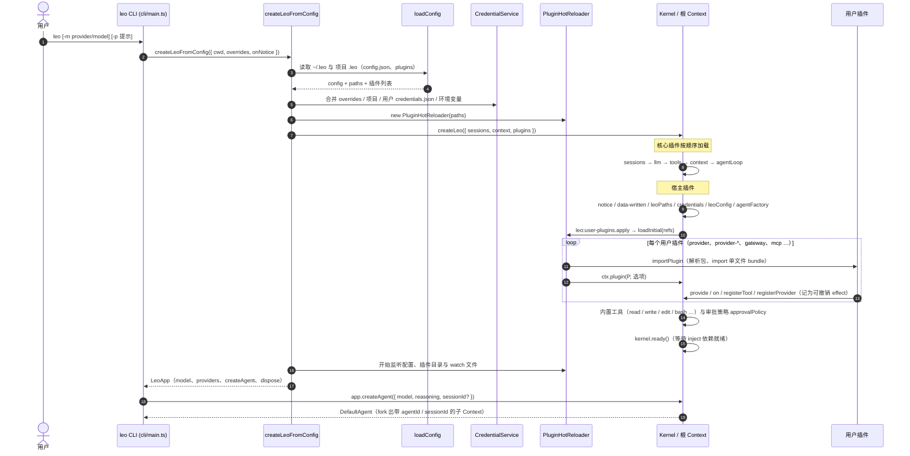
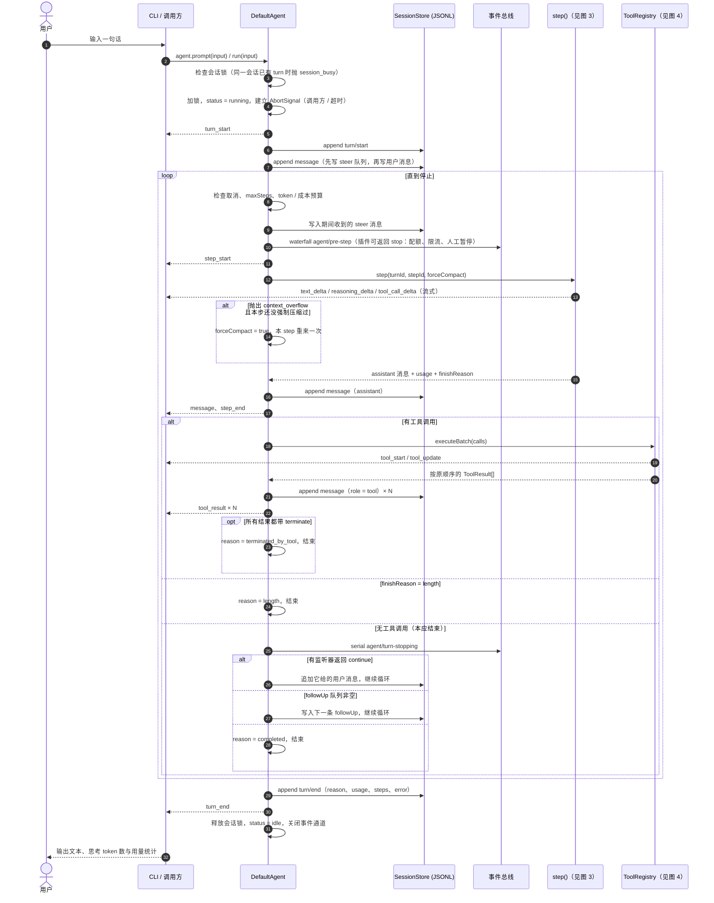
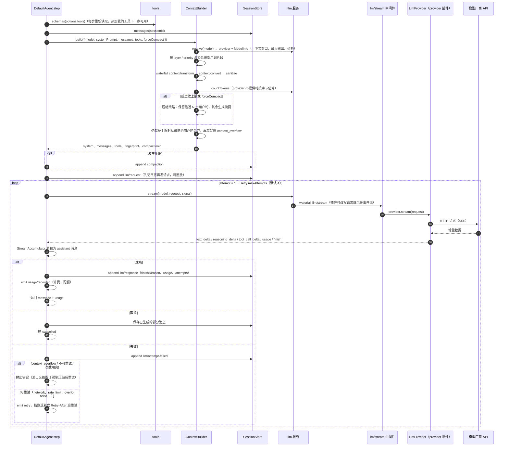
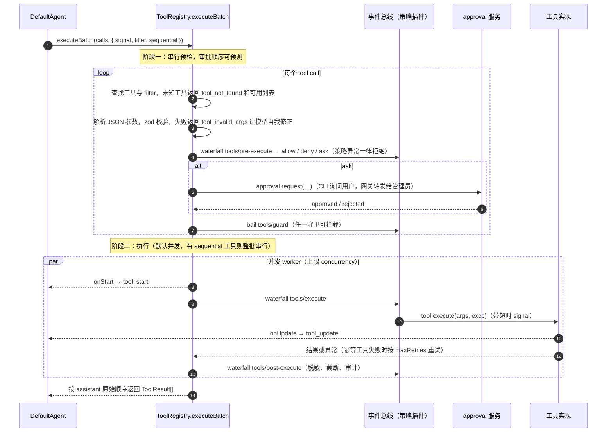
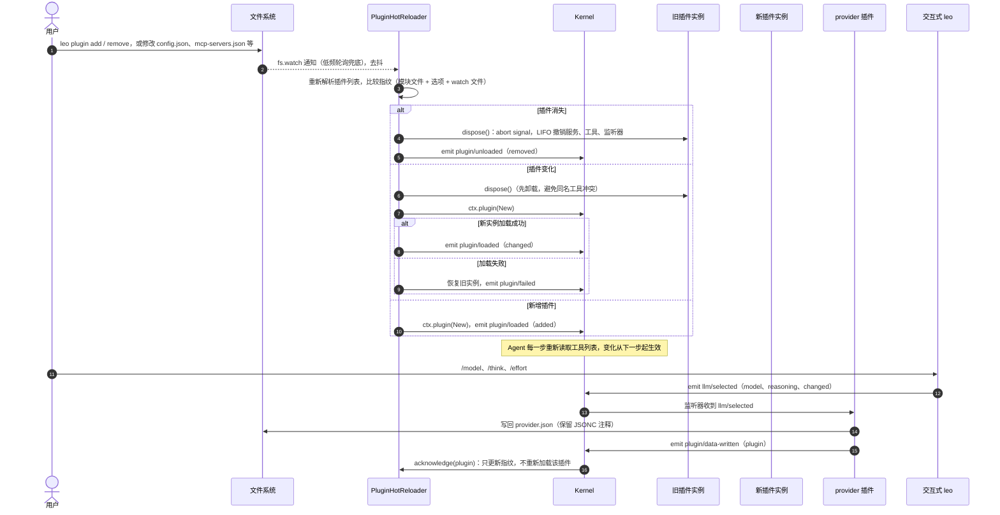
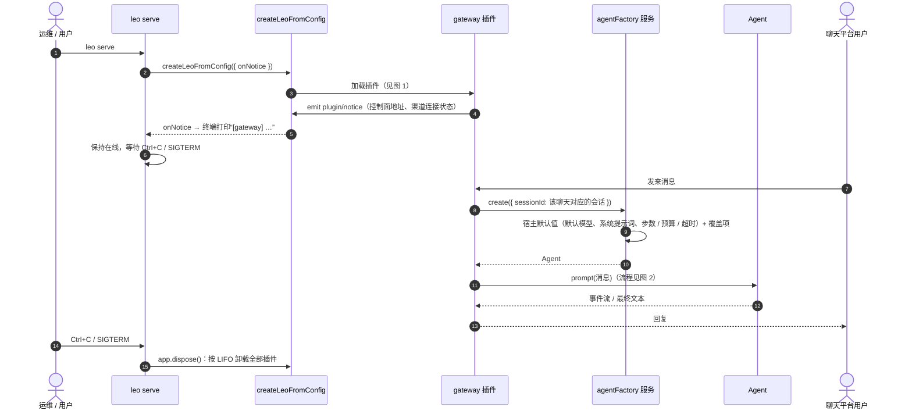

# 时序流程图

本文按当前代码（`src/`）梳理 leo-agents 的主要运行时序，方便阅读源码、开发插件和排查问题。图中的事件名、服务名与代码一致；`waterfall` / `serial` / `bail` / `emit` 是内核的四种事件分发方式（见 `src/kernel/events.ts`）。

| 图 | 场景 | 主要源码 |
| --- | --- | --- |
| 1 | 启动：`leo` → `createLeoFromConfig` → 内核就绪 | `cli/main.ts`、`config/create.ts`、`leo.ts` |
| 2 | 一次对话（turn）的完整循环 | `loop/agent.ts` |
| 3 | 一个 step：构建上下文与调用模型（含重试） | `loop/agent.ts`、`context/builder.ts`、`llm/service.ts` |
| 4 | 工具批量执行：预检、审批、并发执行 | `tools/registry.ts` |
| 5 | 插件热加载与 provider.json 写回 | `config/hot-reload.ts`、`kernel/context.ts` |
| 6 | `leo serve` 常驻：插件按宿主默认值创建 Agent（以网关为例） | `cli/main.ts`、`config/create.ts` |

---

## 1. 启动

要点：

- 底座不内置模型厂商。`app.model` 每次读取时计算：配置里的 `model` 优先，否则取默认 provider（不可用时取第一个可用的）的 `defaultModel`。没有任何可用模型时，`createAgent` 抛出 `auth` 错误，并提示安装 `provider` + `provider-*`。
- 插件注册的一切（服务、工具、监听器）都是 effect，卸载时按 LIFO 顺序撤销。

---

## 2. 一次对话（turn）

停止原因（`StopReason`）：`completed`、`max_steps`、`budget_exceeded`、`rejected`（pre-step 拒绝）、`length`、`terminated_by_tool`、`timeout`、`cancelled`、`error`。每个 AgentEvent 同时以 `agent/event` 旁路广播，供日志与实时推送使用。

---

## 3. 一个 step：构建上下文与调用模型

插件抛出的错误由 `toLeoError` 识别：带 `Symbol.for('leo.error')` 标记或 `name === 'LeoError'` 的错误会保留 `code`、`status`、`retryAfterMs`，以此决定是否重试。

---

## 4. 工具批量执行

---

## 5. 插件热加载与 provider.json 写回

不热更新的部分：模型、内置工具、审批等宿主配置，修改后仍需重启。

---

## 6. `leo serve` 常驻（以网关插件为例）

